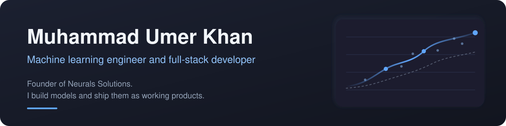

  

I'm a machine learning engineer and full-stack developer based in Multan, Pakistan. For more than three years I have built AI and ML systems for clients and research teams, and I run [Neurals Solutions](https://neuralssolutions.com), a software house that builds data science, web, mobile and desktop products.

My work usually covers the whole path: clean the data, train and test the model properly, then put it behind an app that people can use.

## What I work on

- **Applied machine learning.** Classification, regression and forecasting on tabular, image and text data, with honest validation and uncertainty estimates.
- **Deep learning.** Computer vision and NLP with CNNs, vision transformers and transformer language models.
- **ML for rock and geotechnical engineering.** Rockburst risk, rock strength and soil behaviour from laboratory data.
- **Security analytics.** Intrusion, DDoS and phishing detection.
- **Shipping it.** Flask and React apps, Firebase, AWS Lambda, Android, and browser extensions.

## Selected projects

| Project | What it is | Stack |
| --- | --- | --- |
| [Agentic rockburst assessment](https://github.com/mehmedumer10/agentic-rockburst-assessment) | A multi-agent pipeline that grades rockburst risk and reports its own confidence, packaged with tests and a CLI | Python, scikit-learn, CatBoost |
| [Dark-pattern detector](https://github.com/mehmedumer10/dark-pattern-detector) | A vision and language model that flags manipulative interface design, with a Chrome extension that highlights it on live pages | PyTorch, ViT, RoBERTa, Flask, JavaScript |
| [Network traffic analyser](https://github.com/mehmedumer10/network-traffic-analyser) | A web app that turns a Wireshark capture into flows and labels each one benign or malicious | Flask, LightGBM |
| [Freeze-thaw sandstone strength](https://github.com/mehmedumer10/freeze-thaw-sandstone-strength) | A research pipeline that predicts dynamic rock strength with calibrated prediction intervals | scikit-learn, Optuna, NGBoost, SHAP |
| [CropCare AI](https://github.com/mehmedumer10/cropcare-ai) | Crop-disease diagnosis from a leaf photo across 33 classes, served to an Android app | TensorFlow, Flask, Android, Firebase |
| [Brain tumour MRI classification](https://github.com/mehmedumer10/brain-tumour-mri-classification) | Hybrid VGG and vision-transformer models for four-class MRI classification | PyTorch |
| [Palmprint authentication](https://github.com/mehmedumer10/palmprint-authentication) | Person identification from phone photos of the palm | TensorFlow, OpenCV |
| [Eye disease screening](https://github.com/mehmedumer10/eye-disease-screening) | A CNN and web app that screens retinal photographs for three eye diseases | TensorFlow, Flask |
| [Customer support intent detection](https://github.com/mehmedumer10/customer-support-intent-detection) | Routes customer messages to one of 27 intents | TensorFlow, Keras |

Each repository has a README with the method, the measured results and the limits of the work.

More: [RockburstAI web app](https://github.com/mehmedumer10/rockburst-app) · [ADHD prediction from EEG](https://github.com/mehmedumer10/ADHD-Prediction-Project) · [Phishing website detection](https://github.com/mehmedumer10/Phishing-Website-detection-Using-Deep-Learning) · [SYN attack detection in SDN](https://github.com/mehmedumer10/Syn-Attack-Detection-in-SDN)

## Tools

| Area | Tools |
| --- | --- |
| Languages | Python, JavaScript, Java, SQL |
| Machine learning | scikit-learn, XGBoost, LightGBM, CatBoost, Optuna, SHAP |
| Deep learning | PyTorch, TensorFlow / Keras, Hugging Face Transformers, OpenCV |
| Web and apps | React, Flask, Firebase, Android, Chrome extensions |
| Deployment | AWS Lambda, Docker, Git |

## Work with me

I take on machine learning, data science and full-stack projects through Neurals Solutions.

- Website and case studies: [neuralssolutions.com](https://neuralssolutions.com)
- GitHub: open an issue on any repository, or follow this profile for new work
